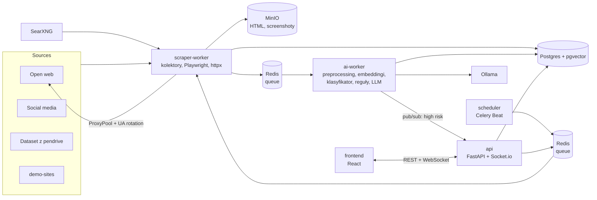

# InvestWatch - koncepcja rozwiązania

**Tytuł roboczy:** InvestWatch - autonomiczny system nadzoru treści finansowych w sieci

**Kontekst:** HackNation 2026, zadanie konkursowe UKNF. Termin oddania: **22.11.2026, 11:00**.

**Decyzje szczegółowe:** [docs/adr/](adr/) (format MADR, po angielsku).

---

## 1. Problem i cel

System automatycznie wyszukuje, agreguje i analizuje treści promocyjne dotyczące instrumentów i usług finansowych na polskim rynku (web + social media). Wspiera UKNF w trzech obszarach:

- **M1 - finfluencerzy i podmioty trzecie:** reklamy zarejestrowanych firm inwestycyjnych (oraz polskojęzyczne reklamy firm zagranicznych działających transgranicznie) publikowane przez osoby trzecie.
- **M2 - zgodność informacji o ryzyku:** materiały marketingowe publikowane bezpośrednio przez firmy inwestycyjne; ocena, czy informacja o ryzyku jest dostateczna, wyraźna i proporcjonalna do informacji o zyskach.
- **M3 - shadow advisory:** podmioty nieautoryzowane (wealth management, investment consulting, family office) faktycznie świadczące doradztwo inwestycyjne.

## 2. Ograniczenia

Z treści zadania:

- Cały stos uruchamiany on-premise jedną komendą: `docker compose up`.
- Wyłącznie darmowe modele AI i otwarte biblioteki. **Zero płatnych zewnętrznych API.**
- Separacja frontend / backend / AI na niezależne serwisy, bez ciężkich narzędzi monorepo.
- Obowiązkowe skanowanie zależności (npm, pip). Sekrety wyłącznie w `.env`.
- README minimalne: Quick Start, wymagania sprzętowe, konfiguracja serwisów. Bez AI slop.
- Jury ocenia m.in.: poprawność scrapingu, trafność klasyfikacji i wpływ thresholdu, płynność UI i powiadomień real-time, bezpieczeństwo bibliotek, **czystość konsoli**.

Z regulaminu:

- Oddanie do 22.11.2026 11:00 - po terminie brak oceny. Laureat musi mieć min. 5/10 pkt.
- Zwycięzca przenosi na UKNF pełne autorskie prawa majątkowe i dostarcza kod z kompletną listą narzędzi i bibliotek. Zakaz zaciemniania kodu.
- Laureat odpowiada za wady prawne - **unikamy bibliotek copyleft (GPL/AGPL)**, preferujemy MIT / Apache 2.0 / BSD. Licencje modeli dokumentujemy.
- Organizator nie zapewnia sprzętu. Sprzęt referencyjny: MacBook M3 Pro, 36 GB RAM.

Kryteria oceny: technologia i gotowość demo 30%, proces wytwarzania z asystentami AI 20%, architektura 20%, zgodność ze specyfikacją i preferowanymi technologiami 20%, efekt "wow" 10%.

## 3. Architektura



### Serwisy (kontenery)

| Serwis | Rola |
|---|---|
| `api` | FastAPI: REST, Socket.io, auth, kalibracja, audit log |
| `scraper-worker` | Celery: kolektory, Playwright, httpx, ProxyPool |
| `ai-worker` | Celery: preprocessing, embeddingi, klasyfikatory, reguły M2, LLM, entity resolution |
| `scheduler` | Celery Beat: cykliczne crawle, `registry-sync`, retencja |
| `frontend` | React + Vite |
| `migrate` | jednorazowy: migracje Alembic + seed rejestru i użytkowników |
| `postgres` | metadane, treść, pgvector, findingi, audit log |
| `redis` | kolejka, pub/sub, hot cache |
| `minio` | object storage: surowy HTML, screenshoty, dowody |
| `ollama` (+ `ollama-init`) | inferencja LLM; init pobiera model |
| `searxng` | self-hosted metasearch do discovery |
| `proxy-1`, `proxy-2` | lokalne proxy (np. tinyproxy) do demonstracji rotacji |
| `demo-sites` | lokalne strony fikcyjnych podmiotów - deterministyczne demo i testy E2E |

### Przepływ

`Collector -> RawDocument -> kolejka -> preprocessing (czyszczenie, normalizacja, hash, dedup) -> embeddingi -> klasyfikator per moduł (score) -> reguły M2 -> LLM dla kandydatów -> entity resolution -> finding -> agregacja w case -> alert WebSocket`.

### Inferencja LLM (ADR-0002)

Docker na macOS nie ma dostępu do GPU (Metal). Domyślnie Ollama działa w compose (CPU), a `LLM_BASE_URL` w `.env` pozwala wskazać natywną Ollamę na hoście (Metal) - używane na demo. Profil GPU dla Linux + NVIDIA.

## 4. Moduły analityczne

Każdy moduł produkuje ten sam typ obiektu `finding` (patrz sekcja 7).

### M1 - finfluencerzy
- Discovery: zapytania `alias firmy x fraza reklamowa` (kod promocyjny, bonus, link w bio), hashtagi, seed lista kanałów finfluencerów.
- Detekcja: klasyfikator "treść reklamowa firmy inwestycyjnej", entity resolution reklamowanej firmy, **detekcja linków afiliacyjnych i kodów promo** (`?ref=`, `?aff=`, `utm_*`, "z kodem X"), brak oznaczenia `#reklama` / `#współpraca`.
- Wynik: firma, reklamujący, treść, URL, dowody współpracy; okresowe odświeżanie.

### M2 - informacja o ryzyku
- Discovery: oficjalne domeny firm z rejestru (strony, landing pages, promocje).
- Rule-set w YAML (ADR-0009) oparty na MiFID II art. 24(3) i rozporządzeniu delegowanym 2017/565 art. 44 oraz ostrzeżeniu ESMA dla CFD. Kryteria m.in.:
  - `risk_warning_present` - jest ostrzeżenie o ryzyku przy wzmiance o korzyściach,
  - `risk_prominence` - **wizualna wyraźność**: rozmiar fontu, kontrast, pozycja disclaimera vs nagłówek o zyskach (screenshot + computed styles z DOM),
  - `profit_risk_balance` - proporcja treści o zyskach do treści o ryzyku,
  - `past_performance_disclaimer`, `forecast_disclaimer`,
  - `cfd_esma_warning` - "X% rachunków inwestorów detalicznych traci pieniądze...".
- Każde kryterium: detektor (regex / klasyfikator / LLM / wizualny), waga, podstawa prawna widoczna w UI.
- Załącznik z wymogami z treści zadania - do pozyskania od mentorów; po otrzymaniu zmieniamy tylko YAML.

### M3 - shadow advisory
- Discovery: taksonomia fraz (doradztwo inwestycyjne, family office, zarządzanie majątkiem, sygnały, gwarantowany zysk, portfel modelowy), lista ostrzeżeń publicznych KNF jako seed.
- Detekcja: klasyfikator "oferta usługi doradczej", entity resolution z wynikiem `authorized: false`, **clone firms i lookalike domains** (podobieństwo do nazw i domen licencjonowanych firm, wiek domeny z WHOIS).
- Wynik: podmiot, treść oferty, URL potencjalnego naruszenia.

## 5. Pipeline AI

Dwa poziomy (ADR-0002, ADR-0011):

1. **Klasyfikator** (każdy dokument, ms na CPU): embeddingi `intfloat/multilingual-e5-base` + lekka głowica (logistic regression) per moduł, **skalibrowane prawdopodobieństwa** (isotonic / Platt). Ten score steruje thresholdem.
2. **LLM** (tylko kandydaci powyżej progu wstępnego): Gemma przez Ollamę - ok. 12B (Q4) na demo przez natywną Ollamę, ok. 4B domyślnie w kontenerze; model w `LLM_MODEL`. Structured output (`format: json` + walidacja Pydantic + retry): `{entities, profit_claims, risk_statements, verdict, rationale}`.

Trening (weak supervision + destylacja):
- Reguły i LLM (offline) etykietują kilkaset dokumentów z datasetu i pierwszego crawla.
- Głowica trenowana na embeddingach w sekundy na CPU.
- Decyzje analityka (`confirmed` / `dismissed`) trafiają do zbioru etykiet; przycisk "Przetrenuj model" podbija `model_version`.
- Prompty wersjonowane w repo (`prompt_version`) z małym zestawem testów ewaluacyjnych.

Alternatywne LLM z licencją Apache 2.0 (Qwen, Mistral) - wymienne przez `.env`, udokumentowane ze względu na przeniesienie praw na UKNF.

## 6. Dane referencyjne i entity resolution

Źródła (ADR-0004):
- rejestry KNF: krajowe firmy inwestycyjne, oddziały firm zagranicznych,
- rejestr ESMA (MiFID): firmy z UE świadczące usługi w PL transgranicznie,
- lista ostrzeżeń publicznych KNF.

Mechanizm: snapshot w repo (`data/`) jako seed + zadanie `registry-sync` w harmonogramie. Entity resolution dopasowuje wzmianki po nazwie (fuzzy, aliasy typu "XTB" / "X-Trade Brokers DM S.A."), domenie, NIP, KRS. Każdy finding ma `entity` z flagą `authorized` i źródłem.

## 7. Model danych

- `source` - konfiguracja źródła / kolektora.
- `document` - URL, kanoniczny URL, platforma, autor, `published_at`, `fetched_at`, `content_hash`, oczyszczony tekst, klucze obiektów w MinIO (HTML, screenshot), embedding (pgvector).
- `entity`, `entity_alias` - rejestr: nazwa, typ, `authorized`, źródło, NIP/KRS/LEI, domeny.
- `mention` - dokument <-> podmiot, rola: `advertised_firm`, `advertiser`, `publisher`, `offering_party`.
- `finding` - **jeden typ dla M1/M2/M3**: `module`, `score`, `model_version`, `prompt_version`, `evidence` (cytaty z offsetami), `explanation`, `details` (JSONB, pola specyficzne dla modułu, np. wyniki kryteriów M2), `status`.
- `case` - agregat findingów wielu modułów i dokumentów wokół jednego podmiotu ("ujednolicony obiekt" ze specyfikacji).
- `label` - decyzje analityka jako ground truth do kalibracji i treningu.
- `audit_log` - kto, co, kiedy (statusy, threshold, retrain, dostęp do dowodów).
- `user` - konta i role.

Statusy findingu: `new -> in_review -> confirmed | dismissed -> escalated`.

## 8. Cache

Klucz bazowy: SHA-256 znormalizowanej treści (ADR-0005).

| Warstwa | Klucz | Gdzie |
|---|---|---|
| Fetch | kanoniczny URL + `ETag` / `Last-Modified` + `content_hash` (też deduplikacja) | Postgres |
| Rejestr | indeks `alias -> entity_id`, przebudowa przy `registry-sync` | Redis |
| Entity resolution | `wzmianka -> entity_id \| null` | Redis |
| Embeddingi | `content_hash + model` | Postgres (pgvector) |
| LLM | `content_hash + model + prompt_version` | Redis |
| Threshold | surowe score'y w bazie; zmiana progu = filtr SQL, bez ponownej inferencji | Postgres |

## 9. Scraping

- **Kolektory jako pluginy** ze wspólnym interfejsem `Collector -> RawDocument` (ADR-0003):
  - open web: Playwright + httpx, SearXNG do discovery,
  - social media: YouTube (yt-dlp: opisy, transkrypcje), następnie TikTok lub Instagram (Playwright, publiczne profile),
  - `dataset`: próbki z pendrive przez ten sam pipeline,
  - `demo-sites`: lokalne strony fikcyjnych podmiotów.
- **Discovery** per moduł + **focused crawling**: priorytet frontieru wg podobieństwa embeddingu kontekstu linku do tematów modułów (ADR-0010).
- **Higiena:** limity i rate limiting per domena, limit głębokości, `robots.txt` respektowany domyślnie (konfigurowalne).
- **ProxyPool** (ADR-0015): lista w `.env` (`PROXY_URLS`), round-robin / sticky per domena, circuit breaker, health-check; pusta lista = połączenie bezpośrednie. Lokalne proxy w compose na demo.
- **Rotacja UA** spójna z nagłówkami (`Accept-Language: pl-PL`, `sec-ch-ua`) i fingerprintem Playwrighta.
- Taksonomie fraz, seedy, źródła i harmonogramy w YAML (`config/`).

## 10. Dashboard

Stack (ADR-0007): React + Vite + TypeScript, shadcn/ui (Radix + Tailwind), Recharts, TanStack Query + Table, socket.io-client. ESLint `no-console`, error boundaries - czysta konsola.

Widoki:
- **Przegląd:** trend incydentów w czasie, liczniki per moduł i poziom ryzyka.
- **Findingi:** tabela z filtrami (data, źródło, poziom ryzyka, moduł), zmiana statusu, szczegóły z podświetlonymi dowodami, screenshotem, kryteriami M2 i podstawą prawną.
- **Case'y + graf powiązań:** finfluencer - firma - domena - kod promo.
- **Skanuj URL teraz:** etapy pipeline'u na żywo przez WebSocket.
- **Kalibracja:** suwak threshold per moduł, precision / recall / FP / FN na etykietach analityka, krzywa PR, "Przetrenuj model".
- **Zdrowie systemu:** długość kolejek, status kolektorów, błędy proxy, ostatni crawl per źródło.
- **Alerty:** toast + licznik dla findingów wysokiego ryzyka (Socket.io).

UI po polsku z plikami i18n (`pl.json`).

## 11. Bezpieczeństwo, RODO, obserwowalność

- **Auth** (ADR-0016): JWT w ciasteczku httpOnly, role `analyst` (przegląd, statusy) i `admin` (threshold, retrain, źródła), użytkownicy seedowani z `.env`, hasła Argon2. Interfejs uwierzytelniania gotowy na podmianę na OIDC (np. Keycloak) przy wdrożeniu w UKNF.
- **Audit log** zmian statusów, progów, retrainu i dostępu do dowodów.
- **Supply chain:** `pip-audit`, `npm audit`, Snyk lub Trivy (również obrazy), gitleaks; lockfile'y; preferencja licencji MIT / Apache / BSD.
- **Sekrety:** wyłącznie `.env`, w repo `.env.example`.
- **RODO** (ADR-0019): minimalizacja danych, konfigurowalny TTL dla dokumentów bez findingu (np. 30 dni), dowody potwierdzonych findingów zachowane, dostęp do surowych dowodów tylko po zalogowaniu i audytowany.
- **Obserwowalność:** strukturalne logi JSON (`structlog`) z `trace_id` przez cały pipeline, zakładka "Zdrowie systemu". Prometheus + Grafana opisane jako ścieżka produkcyjna, poza compose.

## 12. Efekty "wow"

1. Wizualna wyraźność ostrzeżenia o ryzyku (M2) - screenshot + computed styles.
2. Linki afiliacyjne i kody promo jako dowód współpracy (M1).
3. Zabezpieczanie dowodów (chain of custody): screenshot, HTML, SHA-256, timestamp w MinIO; wykrywanie zmian przy ponownym crawlu (np. usunięty disclaimer, skasowany post).
4. Clone firms i lookalike domains (M3).
5. Graf powiązań finfluencer - firma - domena - kod promo.
6. "Skanuj URL teraz" z pipeline'em na żywo.
7. Kalibracja na etykietach analityka (human-in-the-loop, active learning, wersjonowanie modelu).
8. Klastrowanie kampanii (pgvector): ta sama treść u wielu influencerów, wyszukiwarka "znajdź podobne".
9. Raport PDF dla `case` - notatka dla nadzoru z dowodami i hashami.
10. (opcjonalnie) Transkrypcja wideo (faster-whisper) + OCR klatek.

## 13. Struktura repozytorium

Jedno repo bez narzędzi monorepo (ADR-0013). Każdy serwis samodzielny: własny Dockerfile i zależności.

```
invest_watch/
├── services/
│   ├── api/
│   ├── scraper/
│   ├── ai/
│   └── scheduler/
├── frontend/
├── common/            # pakiet Python: schematy Pydantic, modele DB, Alembic, klient Redis
├── config/            # YAML: reguły M2, taksonomie, seedy, źródła
├── data/              # snapshot rejestrów, próbki
├── demo-sites/        # fikcyjne strony do demo i testów E2E
├── infra/             # docker-compose.yml, init SQL, konfig SearXNG / MinIO / proxy
├── docs/              # CONCEPT.md, adr/, AI_PROCESS.md
├── AGENTS.md
├── .env.example
└── README.md
```

Python: `uv`, osobny `pyproject.toml` per serwis, `common` jako zależność ze ścieżki.

## 14. Proces wytwarzania z asystentami AI

Szczegóły w ADR-0012 i (docelowo) `docs/AI_PROCESS.md`.

- Spec-driven: `CONCEPT.md` jako źródło prawdy + ADR-y (MADR) dla każdej kluczowej decyzji (wynik sesji grillingu).
- `AGENTS.md` / `CLAUDE.md` w root i w każdym serwisie: konwencje, komendy, granice modułu, **standard Conventional Commits**.
- Cykl: spec / issue -> implementacja AI -> testy -> review AI (standardy + zgodność ze specyfikacją) -> review człowieka -> merge.
- Bramki CI (GitHub Actions): `ruff`, `eslint` (`no-console`), `pytest`, `vitest`, `pip-audit`, `npm audit`, Snyk / Trivy, gitleaks.
- Prompty LLM jako kod, wersjonowane, z testami ewaluacyjnymi.

## 15. Priorytety

**P0 - szkielet end-to-end**
- `docker compose up` stawia cały stos, migracje, seed rejestru.
- Kolektor open web + `dataset`, kolejka, deduplikacja.
- Preprocessing, embeddingi, klasyfikatory M1/M2/M3 (reguły + głowica), findingi ze score.
- API, dashboard: lista, filtry, trend, alerty WebSocket, zmiana statusu.
- Panel kalibracji z suwakiem i metrykami.
- README (Quick Start).

**P1 - wymogi specyfikacji i najmocniejsze efekty "wow"**
- Kolektor social media (YouTube, potem TikTok lub IG), ProxyPool + rotacja UA.
- Entity resolution, wyjaśnienia LLM, evidence.
- Zabezpieczanie dowodów, wizualna wyraźność ostrzeżenia, linki afiliacyjne.
- "Skanuj URL teraz", auth + audit log, bramki CI.

**P2 - przewaga**
- Widok `case`, graf powiązań, clone firms / lookalike domains, klastrowanie kampanii, raport PDF, "Przetrenuj model", wykrywanie zmian przy re-crawlu.

**P3 - jeśli zostanie czas**
- Transkrypcja wideo i OCR.

**Feature freeze: ok. 8:00 22.11.** Potem tylko stabilizacja, czysta konsola, prezentacja, film.

## 16. Scenariusz demo (ok. 5 min)

1. Przegląd: trend incydentów i liczniki per moduł.
2. "Skanuj URL teraz": pipeline na żywo, toast z alertem wysokiego ryzyka.
3. Finding M2: podświetlone obietnice zysku vs ostrzeżenie, screenshot z porównaniem fontów, kryteria z podstawą prawną.
4. Finding M1: finfluencer, kod promo, link afiliacyjny, podmiot z rejestru.
5. Case + graf: sieć influencerów wokół jednego brokera.
6. M3: shadow advisory i lookalike domain.
7. Kalibracja: suwak -> FP/FN i krzywa PR na żywo; odrzucenie findingu przelicza metryki.
8. Raport PDF dla case'a; slajd z architekturą i procesem AI.

Zabezpieczenie: najpierw prawdziwy URL z sieci; w razie problemów przejście na `demo-sites` (ADR-0017). Strony demo używają wyłącznie fikcyjnych nazw podmiotów.

## 17. Materiały do zgłoszenia

- Tytuł i szczegółowy opis (skrót z tego dokumentu).
- Prezentacja PDF (10-12 slajdów, HTML -> PDF, przygotowywana równolegle od wieczora): problem, rozwiązanie, architektura, M1/M2/M3, kalibracja i human-in-the-loop, dowody, proces AI, bezpieczeństwo, roadmapa wdrożenia w UKNF.
- README: Quick Start, wymagania sprzętowe, konfiguracja serwisów.
- Repozytorium.
- Film ok. 2:30 - nagranie scenariusza demo z lektorem, po feature freeze (ok. 8:30).
- Jeden diagram architektury (Mermaid) wspólny dla README, prezentacji i tego dokumentu.

## 18. Języki

- UI, README, `CONCEPT.md`, `AI_PROCESS.md`, prezentacja: polski.
- Kod, komentarze, commity, ADR-y, `AGENTS.md` / `CLAUDE.md`: angielski.
- Prompty LLM: instrukcje po angielsku, treść analizowana po polsku, cytaty w oryginale.

## 19. Otwarte pytania do mentorów

1. Załącznik z listą wymogów dotyczących informacji o ryzyku (M2).
2. Format i zawartość próbek danych z pendrive (czy są etykiety).
3. Czy na demo wystarczy dataset + jeden działający kolektor social media.
4. Czy jury oczekuje oznaczonego zbioru referencyjnego do pomiaru FP/FN.
